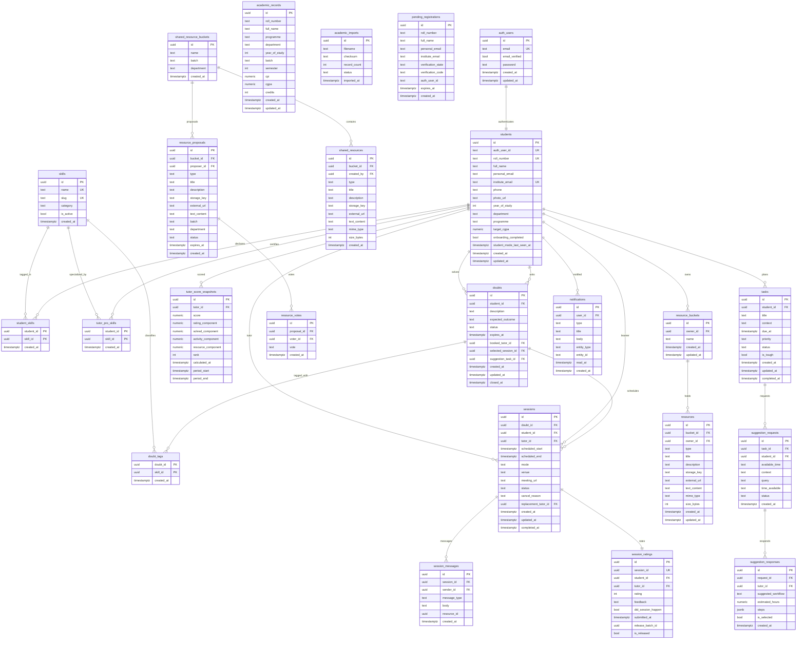

# PeerLearn — Entity Relationship (ER) Diagram & Specification

> **Project**: PeerLearn (Peer-to-Peer Academic Assistance & Knowledge Sharing Platform)  
> **Database Engine**: PostgreSQL (InsForge Backend-as-a-Service)  
> **Target Diagramming Tools**: Draw.io (diagrams.net), Mermaid, PlantUML, dbdiagram.io (DBML)  
> **Total Entities**: 23 tables + 1 external Auth entity (`auth.users`)

---

## Table of Contents

1. [How to Use This in Draw.io (Quick Import Guide)](#1-how-to-use-this-in-drawio-quick-import-guide)
2. [Mermaid ER Diagram (Native Draw.io Import)](#2-mermaid-er-diagram-native-drawio-import)
3. [PlantUML ER Diagram (Alternative Draw.io Import)](#3-plantuml-er-diagram-alternative-drawio-import)
4. [DBML Schema (dbdiagram.io & Interactive Visualizers)](#4-dbml-schema-dbdiagramio--interactive-visualizers)
5. [Draw.io Native XML Specification](#5-drawio-native-xml-specification)
6. [Functional Domain Clusters](#6-functional-domain-clusters)
7. [Comprehensive Entity & Attribute Dictionary](#7-comprehensive-entity--attribute-dictionary)
8. [Relationship & Cardinality Reference Matrix](#8-relationship--cardinality-reference-matrix)
9. [Developer & AI Re-generation Instructions](#9-developer--ai-re-generation-instructions)

---
## 1. How to Use This in Draw.io (Quick Import Guide)

> [!WARNING]
> ### Why You Saw the "Unsupported diagram type: `<mxfile`" Error
> Draw.io has different import dialogs for different formats:
> 1. If you paste `<mxfile>...</mxfile>` XML into **Arrange → Insert → Advanced → Mermaid**, Draw.io will fail with **`Unsupported diagram type: <mxfile`** because that modal only accepts Mermaid text!
> 2. To use the XML code, you must choose **Arrange → Insert → Advanced → XML...**!
> 3. Even easier: You do NOT even need to copy-paste! You can simply open the [PEERLEARN_ERD.drawio](file:///c:/Users/vamsi/OneDrive/Desktop/peerlearn/PEERLEARN_ERD.drawio) file directly in Draw.io (**File → Open From → Device**).

---

### Recommended Methods (Pick Any One):

#### Option 1: Open Native File (Easiest — 1 Click)
1. Go to [app.diagrams.net](https://app.diagrams.net).
2. Click **File** → **Open From** → **Device** (or drag and drop the file).
3. Select `PEERLEARN_ERD.drawio` from your project's root folder.
4. The diagram opens instantly with styled entity cards, formatted fields, domain colors, and orthogonal connectors!

#### Option 2: Paste XML into Draw.io (If importing into existing diagram)
1. In Draw.io top menu, click:  
   **Arrange** → **Insert** → **Advanced** → **XML...**  
   *(Notice: select **XML...**, NOT Mermaid!)*
2. Copy the XML from [Section 5](#5-drawio-native-xml-specification) below.
3. Click **Insert**.

#### Option 3: Import Mermaid Code
1. In Draw.io top menu, click:  
   **Arrange** → **Insert** → **Advanced** → **Mermaid...**
2. Copy ONLY the Mermaid code block from [Section 2](#2-mermaid-er-diagram-native-drawio-import) below (starts with `erDiagram`).
3. Click **Insert**.

#### Option 4: Import PlantUML Code
1. In Draw.io top menu, click:  
   **Arrange** → **Insert** → **Advanced** → **PlantUML...**
2. Copy the PlantUML snippet from [Section 3](#3-plantuml-er-diagram-alternative-drawio-import) below.
3. Click **Insert**.

#### Option 5: dbdiagram.io (Interactive Web Visualizer)
1. Open [dbdiagram.io](https://dbdiagram.io) in any web browser.
2. Paste the DBML script from [Section 4](#4-dbml-schema-dbdiagramio--interactive-visualizers).
3. Experience an interactive diagram with movable entities, searchable fields, and zoom controls.

---

## 2. Mermaid ER Diagram (Native Draw.io Import)

> **Important**: Paste this snippet ONLY into **Arrange → Insert → Advanced → Mermaid...** in Draw.io.



---

## 3. PlantUML ER Diagram (Alternative Draw.io Import)

Draw.io also supports PlantUML directly (**Arrange → Insert → Advanced → PlantUML**):

```plantuml
@startuml PeerLearn_ERD
!theme plain
skinparam linetype ortho
skinparam roundcorner 5
skinparam classFontSize 12
skinparam classFontName "Segoe UI", Arial, sans-serif

entity "auth.users" as auth_users {
  *id : uuid <<PK>>
  --
  *email : text <<UK>>
  email_verified : boolean
  password : text
  created_at : timestamptz
  updated_at : timestamptz
}

entity "students" as students {
  *id : uuid <<PK>>
  --
  *auth_user_id : text <<UK>>
  *roll_number : text <<UK>>
  *full_name : text
  *personal_email : text
  *institute_email : text <<UK>>
  phone : text
  photo_url : text
  *year_of_study : integer
  *department : text
  *programme : text
  target_cgpa : numeric(4,2)
  *onboarding_completed : boolean
  student_mode_last_seen_at : timestamptz
  *created_at : timestamptz
  *updated_at : timestamptz
}

entity "academic_records" as academic_records {
  *id : uuid <<PK>>
  --
  *roll_number : text
  *full_name : text
  *programme : text
  *department : text
  *year_of_study : integer
  *batch : text
  *semester : integer
  *cpi : numeric(4,2)
  *cgpa : numeric(4,2)
  credits : integer
  created_at : timestamptz
  updated_at : timestamptz
}

entity "academic_imports" as academic_imports {
  *id : uuid <<PK>>
  --
  *filename : text
  checksum : text
  record_count : integer
  status : text
  imported_at : timestamptz
}

entity "pending_registrations" as pending_registrations {
  *id : uuid <<PK>>
  --
  *roll_number : text
  *full_name : text
  *personal_email : text
  *institute_email : text
  verification_state : text
  verification_code : text
  auth_user_id : text
  expires_at : timestamptz
  created_at : timestamptz
}

entity "skills" as skills {
  *id : uuid <<PK>>
  --
  *name : text <<UK>>
  *slug : text <<UK>>
  *category : text
  *is_active : boolean
  *created_at : timestamptz
}

entity "student_skills" as student_skills {
  *student_id : uuid <<PK, FK>>
  *skill_id : uuid <<PK, FK>>
  --
  *created_at : timestamptz
}

entity "tutor_pro_skills" as tutor_pro_skills {
  *student_id : uuid <<PK, FK>>
  *skill_id : uuid <<PK, FK>>
  --
  *created_at : timestamptz
}

entity "doubts" as doubts {
  *id : uuid <<PK>>
  --
  *student_id : uuid <<FK>>
  *description : text
  *expected_outcome : text
  *status : text
  *expires_at : timestamptz
  booked_tutor_id : uuid <<FK>>
  selected_session_id : uuid <<FK>>
  suggestion_task_id : uuid <<FK>>
  *created_at : timestamptz
  *updated_at : timestamptz
  closed_at : timestamptz
}

entity "doubt_tags" as doubt_tags {
  *doubt_id : uuid <<PK, FK>>
  *skill_id : uuid <<PK, FK>>
  --
  *created_at : timestamptz
}

entity "sessions" as sessions {
  *id : uuid <<PK>>
  --
  *doubt_id : uuid <<FK>>
  *student_id : uuid <<FK>>
  *tutor_id : uuid <<FK>>
  *scheduled_start : timestamptz
  *scheduled_end : timestamptz
  *mode : text
  venue : text
  meeting_url : text
  *status : text
  cancel_reason : text
  replacement_tutor_id : uuid <<FK>>
  *created_at : timestamptz
  *updated_at : timestamptz
  completed_at : timestamptz
}

entity "session_messages" as session_messages {
  *id : uuid <<PK>>
  --
  *session_id : uuid <<FK>>
  *sender_id : uuid <<FK>>
  *message_type : text
  *body : text
  resource_id : uuid
  *created_at : timestamptz
}

entity "session_ratings" as session_ratings {
  *id : uuid <<PK>>
  --
  *session_id : uuid <<UK, FK>>
  *student_id : uuid <<FK>>
  *tutor_id : uuid <<FK>>
  *rating : integer
  feedback : text
  *did_session_happen : boolean
  *submitted_at : timestamptz
  release_batch_id : uuid
  *is_released : boolean
}

entity "tutor_score_snapshots" as tutor_score_snapshots {
  *id : uuid <<PK>>
  --
  *tutor_id : uuid <<FK>>
  *score : numeric(5,2)
  rating_component : numeric(5,2)
  solved_component : numeric(5,2)
  activity_component : numeric(5,2)
  resource_component : numeric(5,2)
  rank : integer
  *calculated_at : timestamptz
  period_start : timestamptz
  period_end : timestamptz
}

entity "resource_buckets" as resource_buckets {
  *id : uuid <<PK>>
  --
  *owner_id : uuid <<FK>>
  *name : text
  *created_at : timestamptz
  *updated_at : timestamptz
}

entity "resources" as resources {
  *id : uuid <<PK>>
  --
  *bucket_id : uuid <<FK>>
  *owner_id : uuid <<FK>>
  *type : text
  *title : text
  description : text
  storage_key : text
  external_url : text
  text_content : text
  mime_type : text
  size_bytes : bigint
  *created_at : timestamptz
  *updated_at : timestamptz
}

entity "shared_resource_buckets" as shared_resource_buckets {
  *id : uuid <<PK>>
  --
  *name : text
  *batch : text
  *department : text
  *created_at : timestamptz
}

entity "shared_resources" as shared_resources {
  *id : uuid <<PK>>
  --
  *bucket_id : uuid <<FK>>
  *created_by : uuid <<FK>>
  *type : text
  *title : text
  description : text
  storage_key : text
  external_url : text
  text_content : text
  mime_type : text
  size_bytes : bigint
  *created_at : timestamptz
}

entity "resource_proposals" as resource_proposals {
  *id : uuid <<PK>>
  --
  *bucket_id : uuid <<FK>>
  *proposer_id : uuid <<FK>>
  *type : text
  *title : text
  description : text
  storage_key : text
  external_url : text
  text_content : text
  *batch : text
  *department : text
  *status : text
  *expires_at : timestamptz
  *created_at : timestamptz
}

entity "resource_votes" as resource_votes {
  *id : uuid <<PK>>
  --
  *proposal_id : uuid <<FK>>
  *voter_id : uuid <<FK>>
  *vote : text
  *created_at : timestamptz
}

entity "tasks" as tasks {
  *id : uuid <<PK>>
  --
  *student_id : uuid <<FK>>
  *title : text
  context : text
  due_at : timestamptz
  *priority : text
  *status : text
  *is_tough : boolean
  *created_at : timestamptz
  *updated_at : timestamptz
  completed_at : timestamptz
}


entity "suggestion_requests" as suggestion_requests {
  *id : uuid <<PK>>
  --
  *task_id : uuid <<FK>>
  *student_id : uuid <<FK>>
  available_time : text
  context : text
  query : text
  time_available : text
  *status : text
  *created_at : timestamptz
}

entity "suggestion_responses" as suggestion_responses {
  *id : uuid <<PK>>
  --
  *request_id : uuid <<FK>>
  *tutor_id : uuid <<FK>>
  *suggested_workflow : text
  estimated_hours : numeric(4,1)
  steps : jsonb
  is_selected : boolean
  *created_at : timestamptz
}

entity "notifications" as notifications {
  *id : uuid <<PK>>
  --
  *user_id : uuid <<FK>>
  *type : text
  *title : text
  *body : text
  entity_type : text
  entity_id : text
  read_at : timestamptz
  *created_at : timestamptz
}

' --- Relationships ---
auth_users ||--|| students
students ||--o{ student_skills
skills ||--o{ student_skills
students ||--o{ tutor_pro_skills
skills ||--o{ tutor_pro_skills

students ||--o{ doubts : "asks"
students ||--o{ doubts : "booked_as_tutor"
doubts ||--o{ doubt_tags
skills ||--o{ doubt_tags

doubts ||--o{ sessions
students ||--o{ sessions : "as learner"
students ||--o{ sessions : "as tutor"
students ||--o{ sessions : "as replacement"
doubts ||..o| sessions : "selected_session"

sessions ||--o{ session_messages
students ||--o{ session_messages

sessions ||--|| session_ratings
students ||--o{ session_ratings : "as rater"
students ||--o{ session_ratings : "as rated"

students ||--o{ tutor_score_snapshots

students ||--o{ resource_buckets
resource_buckets ||--o{ resources
students ||--o{ resources

shared_resource_buckets ||--o{ shared_resources
students ||--o{ shared_resources
shared_resource_buckets ||--o{ resource_proposals
students ||--o{ resource_proposals
resource_proposals ||--o{ resource_votes
students ||--o{ resource_votes

students ||--o{ tasks
tasks ||--o{ suggestion_requests
students ||--o{ suggestion_requests
suggestion_requests ||--o{ suggestion_responses
students ||--o{ suggestion_responses

students ||--o{ notifications
@enduml
```



---

## 4. DBML Schema (dbdiagram.io & Interactive Visualizers)

You can copy and paste this into [dbdiagram.io](https://dbdiagram.io) to generate an interactive web-based diagram with one click:

```dbml
// ==========================================
// PEERLEARN DATABASE - DBML SPECIFICATION
// ==========================================

Table academic_records {
  id uuid [pk, default: `gen_random_uuid()`]
  roll_number text [not null]
  full_name text [not null]
  programme text [not null]
  department text [not null]
  year_of_study integer [not null]
  batch text [not null]
  semester integer [not null]
  cpi numeric(4,2) [not null]
  cgpa numeric(4,2) [not null]
  credits integer [default: 0]
  created_at timestamptz [not null, default: `now()`]
  updated_at timestamptz [not null, default: `now()`]

  indexes {
    (roll_number, semester) [unique]
    roll_number
  }
}

Table academic_imports {
  id uuid [pk, default: `gen_random_uuid()`]
  filename text [not null]
  checksum text
  record_count integer [default: 0]
  status text [default: 'COMPLETED']
  imported_at timestamptz [not null, default: `now()`]
}

Table pending_registrations {
  id uuid [pk, default: `gen_random_uuid()`]
  roll_number text [not null]
  full_name text [not null]
  personal_email text [not null]
  institute_email text [not null]
  verification_state text [default: 'PENDING']
  verification_code text
  auth_user_id text
  expires_at timestamptz
  created_at timestamptz [not null, default: `now()`]
}

Table students {
  id uuid [pk, default: `gen_random_uuid()`]
  auth_user_id text [unique, not null]
  roll_number text [unique, not null]
  full_name text [not null]
  personal_email text [not null]
  institute_email text [unique, not null]
  phone text
  photo_url text
  year_of_study integer [not null]
  department text [not null]
  programme text [not null]
  target_cgpa numeric(4,2)
  onboarding_completed boolean [not null, default: false]
  student_mode_last_seen_at timestamptz [default: `now()`]
  created_at timestamptz [not null, default: `now()`]
  updated_at timestamptz [not null, default: `now()`]

  indexes {
    roll_number
    institute_email
    auth_user_id
  }
}

Table skills {
  id uuid [pk, default: `gen_random_uuid()`]
  name text [unique, not null]
  slug text [unique, not null]
  category text [not null]
  is_active boolean [not null, default: true]
  created_at timestamptz [not null, default: `now()`]
}

Table student_skills {
  student_id uuid [not null, ref: > students.id]
  skill_id uuid [not null, ref: > skills.id]
  created_at timestamptz [not null, default: `now()`]

  indexes {
    (student_id, skill_id) [pk]
  }
}

Table tutor_pro_skills {
  student_id uuid [not null, ref: > students.id]
  skill_id uuid [not null, ref: > skills.id]
  created_at timestamptz [not null, default: `now()`]

  indexes {
    (student_id, skill_id) [pk]
    (skill_id, student_id)
  }
}

Table doubts {
  id uuid [pk, default: `gen_random_uuid()`]
  student_id uuid [not null, ref: > students.id]
  description text [not null]
  expected_outcome text [not null]
  status text [not null, default: 'OPEN']
  expires_at timestamptz [not null]
  booked_tutor_id uuid [ref: > students.id]
  selected_session_id uuid [ref: > sessions.id]
  suggestion_task_id uuid [ref: > tasks.id]
  created_at timestamptz [not null, default: `now()`]
  updated_at timestamptz [not null, default: `now()`]
  closed_at timestamptz

  indexes {
    (student_id, status)
    (status, expires_at)
  }
}

Table doubt_tags {
  doubt_id uuid [not null, ref: > doubts.id]
  skill_id uuid [not null, ref: > skills.id]
  created_at timestamptz [not null, default: `now()`]

  indexes {
    (doubt_id, skill_id) [pk]
    (skill_id, doubt_id)
  }
}

Table sessions {
  id uuid [pk, default: `gen_random_uuid()`]
  doubt_id uuid [not null, ref: > doubts.id]
  student_id uuid [not null, ref: > students.id]
  tutor_id uuid [not null, ref: > students.id]
  scheduled_start timestamptz [not null]
  scheduled_end timestamptz [not null]
  mode text [not null]
  venue text
  meeting_url text
  status text [not null, default: 'BOOKED']
  cancel_reason text
  replacement_tutor_id uuid [ref: > students.id]
  created_at timestamptz [not null, default: `now()`]
  updated_at timestamptz [not null, default: `now()`]
  completed_at timestamptz

  indexes {
    (student_id, scheduled_start)
    (tutor_id, scheduled_start)
  }
}

Table session_messages {
  id uuid [pk, default: `gen_random_uuid()`]
  session_id uuid [not null, ref: > sessions.id]
  sender_id uuid [not null, ref: > students.id]
  message_type text [not null, default: 'TEXT']
  body text [not null]
  resource_id uuid
  created_at timestamptz [not null, default: `now()`]

  indexes {
    (session_id, created_at)
  }
}

Table session_ratings {
  id uuid [pk, default: `gen_random_uuid()`]
  session_id uuid [unique, not null, ref: - sessions.id]
  student_id uuid [not null, ref: > students.id]
  tutor_id uuid [not null, ref: > students.id]
  rating integer [not null]
  feedback text
  did_session_happen boolean [not null, default: true]
  submitted_at timestamptz [not null, default: `now()`]
  release_batch_id uuid
  is_released boolean [not null, default: false]

  indexes {
    (session_id, student_id) [unique]
  }
}

Table tutor_score_snapshots {
  id uuid [pk, default: `gen_random_uuid()`]
  tutor_id uuid [not null, ref: > students.id]
  score numeric(5,2) [not null, default: 50.00]
  rating_component numeric(5,2) [default: 0]
  solved_component numeric(5,2) [default: 0]
  activity_component numeric(5,2) [default: 0]
  resource_component numeric(5,2) [default: 0]
  rank integer
  calculated_at timestamptz [not null, default: `now()`]
  period_start timestamptz
  period_end timestamptz
}

Table resource_buckets {
  id uuid [pk, default: `gen_random_uuid()`]
  owner_id uuid [not null, ref: > students.id]
  name text [not null]
  created_at timestamptz [not null, default: `now()`]
  updated_at timestamptz [not null, default: `now()`]
}

Table resources {
  id uuid [pk, default: `gen_random_uuid()`]
  bucket_id uuid [not null, ref: > resource_buckets.id]
  owner_id uuid [not null, ref: > students.id]
  type text [not null]
  title text [not null]
  description text
  storage_key text
  external_url text
  text_content text
  mime_type text
  size_bytes bigint
  created_at timestamptz [not null, default: `now()`]
  updated_at timestamptz [not null, default: `now()`]
}

Table shared_resource_buckets {
  id uuid [pk, default: `gen_random_uuid()`]
  name text [not null]
  batch text [not null]
  department text [not null]
  created_at timestamptz [not null, default: `now()`]
}

Table shared_resources {
  id uuid [pk, default: `gen_random_uuid()`]
  bucket_id uuid [not null, ref: > shared_resource_buckets.id]
  created_by uuid [not null, ref: > students.id]
  type text [not null]
  title text [not null]
  description text
  storage_key text
  external_url text
  text_content text
  mime_type text
  size_bytes bigint
  created_at timestamptz [not null, default: `now()`]
}

Table resource_proposals {
  id uuid [pk, default: `gen_random_uuid()`]
  bucket_id uuid [not null, ref: > shared_resource_buckets.id]
  proposer_id uuid [not null, ref: > students.id]
  type text [not null]
  title text [not null]
  description text
  storage_key text
  external_url text
  text_content text
  batch text [not null]
  department text [not null]
  status text [not null, default: 'OPEN']
  expires_at timestamptz [not null]
  created_at timestamptz [not null, default: `now()`]
}

Table resource_votes {
  id uuid [pk, default: `gen_random_uuid()`]
  proposal_id uuid [not null, ref: > resource_proposals.id]
  voter_id uuid [not null, ref: > students.id]
  vote text [not null]
  created_at timestamptz [not null, default: `now()`]

  indexes {
    (proposal_id, voter_id) [unique]
  }
}

Table tasks {
  id uuid [pk, default: `gen_random_uuid()`]
  student_id uuid [not null, ref: > students.id]
  title text [not null]
  context text
  due_at timestamptz
  priority text [not null, default: 'MEDIUM']
  status text [not null, default: 'PENDING']
  is_tough boolean [not null, default: false]
  created_at timestamptz [not null, default: `now()`]
  updated_at timestamptz [not null, default: `now()`]
  completed_at timestamptz

  indexes {
    (student_id, due_at)
  }
}


Table suggestion_requests {
  id uuid [pk, default: `gen_random_uuid()`]
  task_id uuid [not null, ref: > tasks.id]
  student_id uuid [not null, ref: > students.id]
  available_time text
  context text
  query text
  time_available text
  status text [not null, default: 'OPEN']
  created_at timestamptz [not null, default: `now()`]
}

Table suggestion_responses {
  id uuid [pk, default: `gen_random_uuid()`]
  request_id uuid [not null, ref: > suggestion_requests.id]
  tutor_id uuid [not null, ref: > students.id]
  suggested_workflow text [not null]
  estimated_hours numeric(4,1)
  steps jsonb [default: `'[]'`]
  is_selected boolean [default: false]
  created_at timestamptz [not null, default: `now()`]
}

Table notifications {
  id uuid [pk, default: `gen_random_uuid()`]
  user_id uuid [not null, ref: > students.id]
  type text [not null]
  title text [not null]
  body text [not null]
  entity_type text
  entity_id text
  read_at timestamptz
  created_at timestamptz [not null, default: `now()`]

  indexes {
    (user_id, read_at, created_at)
  }
}
```

---

## 5. Draw.io Native XML Specification

To load directly into Draw.io via **Arrange → Insert → Advanced → XML...** (or simply open `PEERLEARN_ERD.drawio` via **File → Open From → Device**):

```xml
<mxfile host="app.diagrams.net" modified="2026-11-02T19:15:00.000Z" agent="Antigravity AI" version="24.0.0" type="device">
  <diagram id="peerlearn-erd-v2" name="PeerLearn Relational ERD (Spacious)">
    <mxGraphModel dx="3800" dy="2600" grid="1" gridSize="10" guides="1" tooltips="1" connect="1" arrows="1" fold="1" page="1" pageScale="1" pageWidth="3800" pageHeight="2600" math="0" shadow="0">
      <root>
        <mxCell id="0" />
        <mxCell id="1" parent="0" />

        <!-- ============================================================= -->
        <!-- LEGEND & CARDINALITY GUIDE (TOP-RIGHT)                        -->
        <!-- ============================================================= -->
        <mxCell id="legend_container" value="&lt;b style=&quot;font-size:15px;&quot;&gt;PEERLEARN RELATIONAL ERD LEGEND&lt;/b&gt;&lt;hr style=&quot;margin:8px 0;&quot;/&gt;&lt;br/&gt;&lt;br/&gt;&lt;br/&gt;&lt;br/&gt;&lt;br/&gt;&lt;br/&gt;&lt;br/&gt;&lt;br/&gt;&lt;br/&gt;&lt;br/&gt;&lt;br/&gt;&lt;br/&gt;&lt;br/&gt;&lt;br/&gt;&lt;br/&gt;&lt;br/&gt;&lt;br/&gt;&lt;br/&gt;&lt;br/&gt;&lt;br/&gt;&lt;br/&gt;&lt;br/&gt;&lt;br/&gt;" style="rounded=1;whiteSpace=wrap;html=1;fillColor=#f8f9fa;strokeColor=#495057;strokeWidth=2;verticalAlign=top;align=left;spacingLeft=16;spacingTop=14;shadow=1;fontFamily=Helvetica;" vertex="1" parent="1">
          <mxGeometry x="2250" y="80" width="520" height="580" as="geometry" />
        </mxCell>

        <!-- Legend Items -->
        <mxCell id="leg_pk" value="&lt;b&gt;+ id: uuid [PK]&lt;/b&gt;" style="text;html=1;fontSize=12;fontStyle=1;align=left;verticalAlign=middle;" vertex="1" parent="1">
          <mxGeometry x="2280" y="130" width="180" height="30" as="geometry" />
        </mxCell>
        <mxCell id="leg_pk_desc" value="Primary Key (Unique surrogate row identifier)" style="text;html=1;fontSize=11;align=left;verticalAlign=middle;" vertex="1" parent="1">
          <mxGeometry x="2470" y="130" width="280" height="30" as="geometry" />
        </mxCell>

        <mxCell id="leg_fk" value="&lt;b&gt;+ fk_id: uuid [FK]&lt;/b&gt;" style="text;html=1;fontSize=12;fontStyle=1;align=left;verticalAlign=middle;fontColor=#004085;" vertex="1" parent="1">
          <mxGeometry x="2280" y="170" width="180" height="30" as="geometry" />
        </mxCell>
        <mxCell id="leg_fk_desc" value="Foreign Key reference (Cascades or Set Null)" style="text;html=1;fontSize=11;align=left;verticalAlign=middle;" vertex="1" parent="1">
          <mxGeometry x="2470" y="170" width="280" height="30" as="geometry" />
        </mxCell>

        <mxCell id="leg_uk" value="&lt;b&gt;+ email: text [UK]&lt;/b&gt;" style="text;html=1;fontSize=12;fontStyle=1;align=left;verticalAlign=middle;fontColor=#28a745;" vertex="1" parent="1">
          <mxGeometry x="2280" y="210" width="180" height="30" as="geometry" />
        </mxCell>
        <mxCell id="leg_uk_desc" value="Unique Candidate Key constraint" style="text;html=1;fontSize=11;align=left;verticalAlign=middle;" vertex="1" parent="1">
          <mxGeometry x="2470" y="210" width="280" height="30" as="geometry" />
        </mxCell>

        <!-- Domain Colors in Legend -->
        <mxCell id="leg_c_blue" value="Identity &amp;amp; Auth" style="rounded=1;whiteSpace=wrap;html=1;fillColor=#dae8fc;strokeColor=#6c8ebf;strokeWidth=1.5;fontSize=11;fontStyle=1;" vertex="1" parent="1">
          <mxGeometry x="2280" y="260" width="120" height="28" as="geometry" />
        </mxCell>
        <mxCell id="leg_c_green" value="Skills &amp;amp; Expertise" style="rounded=1;whiteSpace=wrap;html=1;fillColor=#d5e8d4;strokeColor=#82b366;strokeWidth=1.5;fontSize=11;fontStyle=1;" vertex="1" parent="1">
          <mxGeometry x="2420" y="260" width="120" height="28" as="geometry" />
        </mxCell>
        <mxCell id="leg_c_orange" value="Doubts &amp;amp; Matching" style="rounded=1;whiteSpace=wrap;html=1;fillColor=#ffe6cc;strokeColor=#d79b00;strokeWidth=1.5;fontSize=11;fontStyle=1;" vertex="1" parent="1">
          <mxGeometry x="2560" y="260" width="130" height="28" as="geometry" />
        </mxCell>

        <mxCell id="leg_c_yellow" value="Sessions &amp;amp; Chat" style="rounded=1;whiteSpace=wrap;html=1;fillColor=#fff2cc;strokeColor=#d6b656;strokeWidth=1.5;fontSize=11;fontStyle=1;" vertex="1" parent="1">
          <mxGeometry x="2280" y="300" width="120" height="28" as="geometry" />
        </mxCell>
        <mxCell id="leg_c_purple" value="Ratings &amp;amp; Scores" style="rounded=1;whiteSpace=wrap;html=1;fillColor=#e1d5e7;strokeColor=#9673a6;strokeWidth=1.5;fontSize=11;fontStyle=1;" vertex="1" parent="1">
          <mxGeometry x="2420" y="300" width="120" height="28" as="geometry" />
        </mxCell>
        <mxCell id="leg_c_teal" value="Shared Resources" style="rounded=1;whiteSpace=wrap;html=1;fillColor=#b0e3e6;strokeColor=#0e8088;strokeWidth=1.5;fontSize=11;fontStyle=1;" vertex="1" parent="1">
          <mxGeometry x="2560" y="300" width="130" height="28" as="geometry" />
        </mxCell>

        <mxCell id="leg_c_red" value="Planner Tasks" style="rounded=1;whiteSpace=wrap;html=1;fillColor=#f8cecc;strokeColor=#b85450;strokeWidth=1.5;fontSize=11;fontStyle=1;" vertex="1" parent="1">
          <mxGeometry x="2280" y="340" width="120" height="28" as="geometry" />
        </mxCell>
        <mxCell id="leg_c_grey" value="Private Buckets" style="rounded=1;whiteSpace=wrap;html=1;fillColor=#f5f5f5;strokeColor=#666666;strokeWidth=1.5;fontSize=11;fontStyle=1;" vertex="1" parent="1">
          <mxGeometry x="2420" y="340" width="120" height="28" as="geometry" />
        </mxCell>
        <mxCell id="leg_c_plum" value="Notifications" style="rounded=1;whiteSpace=wrap;html=1;fillColor=#e6d0de;strokeColor=#996185;strokeWidth=1.5;fontSize=11;fontStyle=1;" vertex="1" parent="1">
          <mxGeometry x="2560" y="340" width="130" height="28" as="geometry" />
        </mxCell>

        <!-- Crow Foot Symbols in Legend -->
        <mxCell id="leg_cf_title" value="&lt;b&gt;Crow's Foot Relationship Notations:&lt;/b&gt;" style="text;html=1;fontSize=12;fontStyle=1;align=left;verticalAlign=middle;" vertex="1" parent="1">
          <mxGeometry x="2280" y="390" width="300" height="26" as="geometry" />
        </mxCell>
        <mxCell id="leg_cf_11" value="Mandatory 1 to 1 (|| —— ||)" style="text;html=1;fontSize=11;align=left;verticalAlign=middle;" vertex="1" parent="1">
          <mxGeometry x="2280" y="425" width="240" height="24" as="geometry" />
        </mxCell>
        <mxCell id="leg_cf_1n" value="Mandatory 1 to Many (|| —— |&amp;lt;)" style="text;html=1;fontSize=11;align=left;verticalAlign=middle;" vertex="1" parent="1">
          <mxGeometry x="2280" y="455" width="240" height="24" as="geometry" />
        </mxCell>
        <mxCell id="leg_cf_0n" value="Optional 0 to Many (o| —— &amp;gt;o)" style="text;html=1;fontSize=11;align=left;verticalAlign=middle;" vertex="1" parent="1">
          <mxGeometry x="2280" y="485" width="240" height="24" as="geometry" />
        </mxCell>
        <mxCell id="leg_cf_rule" value="&lt;i&gt;Note: Subtasks have been completely removed from schema &amp;amp; ERD as requested.&lt;/i&gt;" style="text;html=1;fontSize=11;align=left;verticalAlign=middle;fontColor=#721c24;" vertex="1" parent="1">
          <mxGeometry x="2280" y="530" width="460" height="40" as="geometry" />
        </mxCell>

        <!-- ============================================================= -->
        <!-- ROW 1: ACADEMIC GROUND TRUTH & AUTHENTICATION                 -->
        <!-- ============================================================= -->
        <!-- academic_records -->
        <mxCell id="ent_academic_records" value="&lt;b style=&quot;font-size:14px;&quot;&gt;academic_records&lt;/b&gt;&lt;hr style=&quot;margin:6px 0;&quot;/&gt;&lt;b&gt;+ id: uuid [PK]&lt;/b&gt;&lt;br/&gt;&lt;b&gt;+ roll_number: text [UK]&lt;/b&gt;&lt;br/&gt;&lt;b&gt;+ semester: integer [UK]&lt;/b&gt;&lt;br/&gt;+ full_name: text&lt;br/&gt;+ programme: text&lt;br/&gt;+ department: text&lt;br/&gt;+ year_of_study: integer&lt;br/&gt;+ batch: text&lt;br/&gt;+ cpi: numeric(4,2)&lt;br/&gt;+ cgpa: numeric(4,2)&lt;br/&gt;+ credits: integer&lt;br/&gt;+ created_at: timestamptz&lt;br/&gt;+ updated_at: timestamptz" style="rounded=1;whiteSpace=wrap;html=1;align=left;verticalAlign=top;spacingLeft=12;spacingTop=10;spacingRight=12;spacingBottom=10;fillColor=#fad7ac;strokeColor=#b46504;strokeWidth=2;shadow=1;fontFamily=Helvetica;fontSize=11;" vertex="1" parent="1">
          <mxGeometry x="120" y="80" width="280" height="240" as="geometry" />
        </mxCell>

        <!-- academic_imports -->
        <mxCell id="ent_academic_imports" value="&lt;b style=&quot;font-size:14px;&quot;&gt;academic_imports&lt;/b&gt;&lt;hr style=&quot;margin:6px 0;&quot;/&gt;&lt;b&gt;+ id: uuid [PK]&lt;/b&gt;&lt;br/&gt;+ filename: text&lt;br/&gt;+ checksum: text&lt;br/&gt;+ record_count: integer&lt;br/&gt;+ status: text&lt;br/&gt;+ imported_at: timestamptz" style="rounded=1;whiteSpace=wrap;html=1;align=left;verticalAlign=top;spacingLeft=12;spacingTop=10;spacingRight=12;spacingBottom=10;fillColor=#fad7ac;strokeColor=#b46504;strokeWidth=2;shadow=1;fontFamily=Helvetica;fontSize=11;" vertex="1" parent="1">
          <mxGeometry x="460" y="80" width="260" height="150" as="geometry" />
        </mxCell>

        <!-- pending_registrations -->
        <mxCell id="ent_pending_registrations" value="&lt;b style=&quot;font-size:14px;&quot;&gt;pending_registrations&lt;/b&gt;&lt;hr style=&quot;margin:6px 0;&quot;/&gt;&lt;b&gt;+ id: uuid [PK]&lt;/b&gt;&lt;br/&gt;+ roll_number: text&lt;br/&gt;+ full_name: text&lt;br/&gt;+ personal_email: text&lt;br/&gt;+ institute_email: text&lt;br/&gt;+ verification_state: text&lt;br/&gt;+ verification_code: text&lt;br/&gt;+ auth_user_id: text&lt;br/&gt;+ expires_at: timestamptz&lt;br/&gt;+ created_at: timestamptz" style="rounded=1;whiteSpace=wrap;html=1;align=left;verticalAlign=top;spacingLeft=12;spacingTop=10;spacingRight=12;spacingBottom=10;fillColor=#dae8fc;strokeColor=#6c8ebf;strokeWidth=2;shadow=1;fontFamily=Helvetica;fontSize=11;" vertex="1" parent="1">
          <mxGeometry x="780" y="80" width="280" height="210" as="geometry" />
        </mxCell>

        <!-- auth_users -->
        <mxCell id="ent_auth_users" value="&lt;b style=&quot;font-size:14px;&quot;&gt;auth.users&lt;/b&gt;&lt;hr style=&quot;margin:6px 0;&quot;/&gt;&lt;b&gt;+ id: uuid [PK]&lt;/b&gt;&lt;br/&gt;&lt;b&gt;+ email: text [UK]&lt;/b&gt;&lt;br/&gt;+ email_verified: boolean&lt;br/&gt;+ password: text&lt;br/&gt;+ created_at: timestamptz&lt;br/&gt;+ updated_at: timestamptz" style="rounded=1;whiteSpace=wrap;html=1;align=left;verticalAlign=top;spacingLeft=12;spacingTop=10;spacingRight=12;spacingBottom=10;fillColor=#dae8fc;strokeColor=#6c8ebf;strokeWidth=2;shadow=1;fontFamily=Helvetica;fontSize=11;" vertex="1" parent="1">
          <mxGeometry x="1120" y="80" width="260" height="160" as="geometry" />
        </mxCell>

        <!-- ============================================================= -->
        <!-- ROW 2: CORE STUDENTS IDENTITY & SKILLS CATALOG                -->
        <!-- ============================================================= -->
        <!-- skills -->
        <mxCell id="ent_skills" value="&lt;b style=&quot;font-size:14px;&quot;&gt;skills&lt;/b&gt;&lt;hr style=&quot;margin:6px 0;&quot;/&gt;&lt;b&gt;+ id: uuid [PK]&lt;/b&gt;&lt;br/&gt;&lt;b&gt;+ name: text [UK]&lt;/b&gt;&lt;br/&gt;&lt;b&gt;+ slug: text [UK]&lt;/b&gt;&lt;br/&gt;+ category: text&lt;br/&gt;+ is_active: boolean&lt;br/&gt;+ created_at: timestamptz" style="rounded=1;whiteSpace=wrap;html=1;align=left;verticalAlign=top;spacingLeft=12;spacingTop=10;spacingRight=12;spacingBottom=10;fillColor=#d5e8d4;strokeColor=#82b366;strokeWidth=2;shadow=1;fontFamily=Helvetica;fontSize=11;" vertex="1" parent="1">
          <mxGeometry x="120" y="520" width="260" height="160" as="geometry" />
        </mxCell>

        <!-- student_skills -->
        <mxCell id="ent_student_skills" value="&lt;b style=&quot;font-size:14px;&quot;&gt;student_skills&lt;/b&gt;&lt;hr style=&quot;margin:6px 0;&quot;/&gt;&lt;b&gt;+ student_id: uuid [PK, FK]&lt;/b&gt;&lt;br/&gt;&lt;b&gt;+ skill_id: uuid [PK, FK]&lt;/b&gt;&lt;br/&gt;+ created_at: timestamptz" style="rounded=1;whiteSpace=wrap;html=1;align=left;verticalAlign=top;spacingLeft=12;spacingTop=10;spacingRight=12;spacingBottom=10;fillColor=#d5e8d4;strokeColor=#82b366;strokeWidth=2;shadow=1;fontFamily=Helvetica;fontSize=11;" vertex="1" parent="1">
          <mxGeometry x="440" y="520" width="260" height="130" as="geometry" />
        </mxCell>

        <!-- students (CORE HUB) -->
        <mxCell id="ent_students" value="&lt;b style=&quot;font-size:15px;&quot;&gt;students&lt;/b&gt;&lt;hr style=&quot;margin:6px 0;&quot;/&gt;&lt;b&gt;+ id: uuid [PK]&lt;/b&gt;&lt;br/&gt;&lt;b&gt;+ auth_user_id: text [UK, FK]&lt;/b&gt;&lt;br/&gt;&lt;b&gt;+ roll_number: text [UK]&lt;/b&gt;&lt;br/&gt;+ full_name: text&lt;br/&gt;+ personal_email: text&lt;br/&gt;&lt;b&gt;+ institute_email: text [UK]&lt;/b&gt;&lt;br/&gt;+ phone: text&lt;br/&gt;+ photo_url: text&lt;br/&gt;+ year_of_study: integer&lt;br/&gt;+ department: text&lt;br/&gt;+ programme: text&lt;br/&gt;+ target_cgpa: numeric(4,2)&lt;br/&gt;+ onboarding_completed: boolean&lt;br/&gt;+ student_mode_last_seen_at: timestamptz&lt;br/&gt;+ created_at: timestamptz&lt;br/&gt;+ updated_at: timestamptz" style="rounded=1;whiteSpace=wrap;html=1;align=left;verticalAlign=top;spacingLeft=12;spacingTop=10;spacingRight=12;spacingBottom=10;fillColor=#dae8fc;strokeColor=#6c8ebf;strokeWidth=2.5;shadow=1;fontFamily=Helvetica;fontSize=11;" vertex="1" parent="1">
          <mxGeometry x="780" y="480" width="300" height="340" as="geometry" />
        </mxCell>

        <!-- tutor_pro_skills -->
        <mxCell id="ent_tutor_pro_skills" value="&lt;b style=&quot;font-size:14px;&quot;&gt;tutor_pro_skills&lt;/b&gt;&lt;hr style=&quot;margin:6px 0;&quot;/&gt;&lt;b&gt;+ student_id: uuid [PK, FK]&lt;/b&gt;&lt;br/&gt;&lt;b&gt;+ skill_id: uuid [PK, FK]&lt;/b&gt;&lt;br/&gt;+ created_at: timestamptz" style="rounded=1;whiteSpace=wrap;html=1;align=left;verticalAlign=top;spacingLeft=12;spacingTop=10;spacingRight=12;spacingBottom=10;fillColor=#d5e8d4;strokeColor=#82b366;strokeWidth=2;shadow=1;fontFamily=Helvetica;fontSize=11;" vertex="1" parent="1">
          <mxGeometry x="1160" y="520" width="260" height="130" as="geometry" />
        </mxCell>

        <!-- tutor_score_snapshots -->
        <mxCell id="ent_tutor_score_snapshots" value="&lt;b style=&quot;font-size:14px;&quot;&gt;tutor_score_snapshots&lt;/b&gt;&lt;hr style=&quot;margin:6px 0;&quot;/&gt;&lt;b&gt;+ id: uuid [PK]&lt;/b&gt;&lt;br/&gt;&lt;b&gt;+ tutor_id: uuid [FK]&lt;/b&gt;&lt;br/&gt;+ score: numeric(5,2)&lt;br/&gt;+ rating_component: numeric(5,2)&lt;br/&gt;+ solved_component: numeric(5,2)&lt;br/&gt;+ activity_component: numeric(5,2)&lt;br/&gt;+ resource_component: numeric(5,2)&lt;br/&gt;+ rank: integer&lt;br/&gt;+ calculated_at: timestamptz&lt;br/&gt;+ period_start: timestamptz&lt;br/&gt;+ period_end: timestamptz" style="rounded=1;whiteSpace=wrap;html=1;align=left;verticalAlign=top;spacingLeft=12;spacingTop=10;spacingRight=12;spacingBottom=10;fillColor=#e1d5e7;strokeColor=#9673a6;strokeWidth=2;shadow=1;fontFamily=Helvetica;fontSize=11;" vertex="1" parent="1">
          <mxGeometry x="1500" y="500" width="280" height="240" as="geometry" />
        </mxCell>

        <!-- ============================================================= -->
        <!-- ROW 3: DOUBTS, MATCHING & LIVE SESSIONS                       -->
        <!-- ============================================================= -->
        <!-- doubt_tags -->
        <mxCell id="ent_doubt_tags" value="&lt;b style=&quot;font-size:14px;&quot;&gt;doubt_tags&lt;/b&gt;&lt;hr style=&quot;margin:6px 0;&quot;/&gt;&lt;b&gt;+ doubt_id: uuid [PK, FK]&lt;/b&gt;&lt;br/&gt;&lt;b&gt;+ skill_id: uuid [PK, FK]&lt;/b&gt;&lt;br/&gt;+ created_at: timestamptz" style="rounded=1;whiteSpace=wrap;html=1;align=left;verticalAlign=top;spacingLeft=12;spacingTop=10;spacingRight=12;spacingBottom=10;fillColor=#ffe6cc;strokeColor=#d79b00;strokeWidth=2;shadow=1;fontFamily=Helvetica;fontSize=11;" vertex="1" parent="1">
          <mxGeometry x="120" y="1030" width="260" height="130" as="geometry" />
        </mxCell>

        <!-- doubts -->
        <mxCell id="ent_doubts" value="&lt;b style=&quot;font-size:14px;&quot;&gt;doubts&lt;/b&gt;&lt;hr style=&quot;margin:6px 0;&quot;/&gt;&lt;b&gt;+ id: uuid [PK]&lt;/b&gt;&lt;br/&gt;&lt;b&gt;+ student_id: uuid [FK]&lt;/b&gt;&lt;br/&gt;+ description: text&lt;br/&gt;+ expected_outcome: text&lt;br/&gt;+ status: text&lt;br/&gt;+ expires_at: timestamptz&lt;br/&gt;+ booked_tutor_id: uuid [FK]&lt;br/&gt;+ selected_session_id: uuid [FK]&lt;br/&gt;+ suggestion_task_id: uuid [FK]&lt;br/&gt;+ created_at: timestamptz&lt;br/&gt;+ updated_at: timestamptz&lt;br/&gt;+ closed_at: timestamptz" style="rounded=1;whiteSpace=wrap;html=1;align=left;verticalAlign=top;spacingLeft=12;spacingTop=10;spacingRight=12;spacingBottom=10;fillColor=#ffe6cc;strokeColor=#d79b00;strokeWidth=2;shadow=1;fontFamily=Helvetica;fontSize=11;" vertex="1" parent="1">
          <mxGeometry x="440" y="980" width="280" height="260" as="geometry" />
        </mxCell>

        <!-- sessions -->
        <mxCell id="ent_sessions" value="&lt;b style=&quot;font-size:14px;&quot;&gt;sessions&lt;/b&gt;&lt;hr style=&quot;margin:6px 0;&quot;/&gt;&lt;b&gt;+ id: uuid [PK]&lt;/b&gt;&lt;br/&gt;&lt;b&gt;+ doubt_id: uuid [FK]&lt;/b&gt;&lt;br/&gt;&lt;b&gt;+ student_id: uuid [FK]&lt;/b&gt;&lt;br/&gt;&lt;b&gt;+ tutor_id: uuid [FK]&lt;/b&gt;&lt;br/&gt;+ scheduled_start: timestamptz&lt;br/&gt;+ scheduled_end: timestamptz&lt;br/&gt;+ mode: text&lt;br/&gt;+ venue: text&lt;br/&gt;+ meeting_url: text&lt;br/&gt;+ status: text&lt;br/&gt;+ cancel_reason: text&lt;br/&gt;+ replacement_tutor_id: uuid [FK]&lt;br/&gt;+ created_at: timestamptz&lt;br/&gt;+ updated_at: timestamptz&lt;br/&gt;+ completed_at: timestamptz" style="rounded=1;whiteSpace=wrap;html=1;align=left;verticalAlign=top;spacingLeft=12;spacingTop=10;spacingRight=12;spacingBottom=10;fillColor=#fff2cc;strokeColor=#d6b656;strokeWidth=2.5;shadow=1;fontFamily=Helvetica;fontSize=11;" vertex="1" parent="1">
          <mxGeometry x="780" y="980" width="300" height="290" as="geometry" />
        </mxCell>

        <!-- session_messages -->
        <mxCell id="ent_session_messages" value="&lt;b style=&quot;font-size:14px;&quot;&gt;session_messages&lt;/b&gt;&lt;hr style=&quot;margin:6px 0;&quot;/&gt;&lt;b&gt;+ id: uuid [PK]&lt;/b&gt;&lt;br/&gt;&lt;b&gt;+ session_id: uuid [FK]&lt;/b&gt;&lt;br/&gt;&lt;b&gt;+ sender_id: uuid [FK]&lt;/b&gt;&lt;br/&gt;+ message_type: text&lt;br/&gt;+ body: text&lt;br/&gt;+ resource_id: uuid&lt;br/&gt;+ created_at: timestamptz" style="rounded=1;whiteSpace=wrap;html=1;align=left;verticalAlign=top;spacingLeft=12;spacingTop=10;spacingRight=12;spacingBottom=10;fillColor=#fff2cc;strokeColor=#d6b656;strokeWidth=2;shadow=1;fontFamily=Helvetica;fontSize=11;" vertex="1" parent="1">
          <mxGeometry x="1160" y="1010" width="260" height="170" as="geometry" />
        </mxCell>

        <!-- session_ratings -->
        <mxCell id="ent_session_ratings" value="&lt;b style=&quot;font-size:14px;&quot;&gt;session_ratings&lt;/b&gt;&lt;hr style=&quot;margin:6px 0;&quot;/&gt;&lt;b&gt;+ id: uuid [PK]&lt;/b&gt;&lt;br/&gt;&lt;b&gt;+ session_id: uuid [UK, FK]&lt;/b&gt;&lt;br/&gt;&lt;b&gt;+ student_id: uuid [FK]&lt;/b&gt;&lt;br/&gt;&lt;b&gt;+ tutor_id: uuid [FK]&lt;/b&gt;&lt;br/&gt;+ rating: integer (1..5)&lt;br/&gt;+ feedback: text&lt;br/&gt;+ did_session_happen: boolean&lt;br/&gt;+ submitted_at: timestamptz&lt;br/&gt;+ release_batch_id: uuid&lt;br/&gt;+ is_released: boolean" style="rounded=1;whiteSpace=wrap;html=1;align=left;verticalAlign=top;spacingLeft=12;spacingTop=10;spacingRight=12;spacingBottom=10;fillColor=#e1d5e7;strokeColor=#9673a6;strokeWidth=2;shadow=1;fontFamily=Helvetica;fontSize=11;" vertex="1" parent="1">
          <mxGeometry x="1500" y="1000" width="270" height="220" as="geometry" />
        </mxCell>

        <!-- ============================================================= -->
        <!-- ROW 4: PRIVATE & SHARED RESOURCES REPOSITORY                  -->
        <!-- ============================================================= -->
        <!-- resource_buckets -->
        <mxCell id="ent_resource_buckets" value="&lt;b style=&quot;font-size:14px;&quot;&gt;resource_buckets&lt;/b&gt;&lt;hr style=&quot;margin:6px 0;&quot;/&gt;&lt;b&gt;+ id: uuid [PK]&lt;/b&gt;&lt;br/&gt;&lt;b&gt;+ owner_id: uuid [FK]&lt;/b&gt;&lt;br/&gt;+ name: text&lt;br/&gt;+ created_at: timestamptz&lt;br/&gt;+ updated_at: timestamptz" style="rounded=1;whiteSpace=wrap;html=1;align=left;verticalAlign=top;spacingLeft=12;spacingTop=10;spacingRight=12;spacingBottom=10;fillColor=#f5f5f5;strokeColor=#666666;strokeWidth=2;shadow=1;fontFamily=Helvetica;fontSize=11;" vertex="1" parent="1">
          <mxGeometry x="120" y="1520" width="260" height="140" as="geometry" />
        </mxCell>

        <!-- resources -->
        <mxCell id="ent_resources" value="&lt;b style=&quot;font-size:14px;&quot;&gt;resources&lt;/b&gt;&lt;hr style=&quot;margin:6px 0;&quot;/&gt;&lt;b&gt;+ id: uuid [PK]&lt;/b&gt;&lt;br/&gt;&lt;b&gt;+ bucket_id: uuid [FK]&lt;/b&gt;&lt;br/&gt;&lt;b&gt;+ owner_id: uuid [FK]&lt;/b&gt;&lt;br/&gt;+ type: text&lt;br/&gt;+ title: text&lt;br/&gt;+ description: text&lt;br/&gt;+ storage_key: text&lt;br/&gt;+ external_url: text&lt;br/&gt;+ text_content: text&lt;br/&gt;+ mime_type: text&lt;br/&gt;+ size_bytes: bigint&lt;br/&gt;+ created_at: timestamptz&lt;br/&gt;+ updated_at: timestamptz" style="rounded=1;whiteSpace=wrap;html=1;align=left;verticalAlign=top;spacingLeft=12;spacingTop=10;spacingRight=12;spacingBottom=10;fillColor=#f5f5f5;strokeColor=#666666;strokeWidth=2;shadow=1;fontFamily=Helvetica;fontSize=11;" vertex="1" parent="1">
          <mxGeometry x="440" y="1480" width="270" height="270" as="geometry" />
        </mxCell>

        <!-- shared_resource_buckets -->
        <mxCell id="ent_shared_resource_buckets" value="&lt;b style=&quot;font-size:14px;&quot;&gt;shared_resource_buckets&lt;/b&gt;&lt;hr style=&quot;margin:6px 0;&quot;/&gt;&lt;b&gt;+ id: uuid [PK]&lt;/b&gt;&lt;br/&gt;+ name: text&lt;br/&gt;+ batch: text&lt;br/&gt;+ department: text&lt;br/&gt;+ created_at: timestamptz" style="rounded=1;whiteSpace=wrap;html=1;align=left;verticalAlign=top;spacingLeft=12;spacingTop=10;spacingRight=12;spacingBottom=10;fillColor=#bac8d3;strokeColor=#23445d;strokeWidth=2;shadow=1;fontFamily=Helvetica;fontSize=11;" vertex="1" parent="1">
          <mxGeometry x="780" y="1520" width="270" height="140" as="geometry" />
        </mxCell>

        <!-- shared_resources -->
        <mxCell id="ent_shared_resources" value="&lt;b style=&quot;font-size:14px;&quot;&gt;shared_resources&lt;/b&gt;&lt;hr style=&quot;margin:6px 0;&quot;/&gt;&lt;b&gt;+ id: uuid [PK]&lt;/b&gt;&lt;br/&gt;&lt;b&gt;+ bucket_id: uuid [FK]&lt;/b&gt;&lt;br/&gt;&lt;b&gt;+ created_by: uuid [FK]&lt;/b&gt;&lt;br/&gt;+ type: text&lt;br/&gt;+ title: text&lt;br/&gt;+ description: text&lt;br/&gt;+ storage_key: text&lt;br/&gt;+ external_url: text&lt;br/&gt;+ text_content: text&lt;br/&gt;+ mime_type: text&lt;br/&gt;+ size_bytes: bigint&lt;br/&gt;+ created_at: timestamptz" style="rounded=1;whiteSpace=wrap;html=1;align=left;verticalAlign=top;spacingLeft=12;spacingTop=10;spacingRight=12;spacingBottom=10;fillColor=#bac8d3;strokeColor=#23445d;strokeWidth=2;shadow=1;fontFamily=Helvetica;fontSize=11;" vertex="1" parent="1">
          <mxGeometry x="1120" y="1480" width="270" height="250" as="geometry" />
        </mxCell>

        <!-- resource_proposals -->
        <mxCell id="ent_resource_proposals" value="&lt;b style=&quot;font-size:14px;&quot;&gt;resource_proposals&lt;/b&gt;&lt;hr style=&quot;margin:6px 0;&quot;/&gt;&lt;b&gt;+ id: uuid [PK]&lt;/b&gt;&lt;br/&gt;&lt;b&gt;+ bucket_id: uuid [FK]&lt;/b&gt;&lt;br/&gt;&lt;b&gt;+ proposer_id: uuid [FK]&lt;/b&gt;&lt;br/&gt;+ type: text&lt;br/&gt;+ title: text&lt;br/&gt;+ description: text&lt;br/&gt;+ storage_key: text&lt;br/&gt;+ external_url: text&lt;br/&gt;+ text_content: text&lt;br/&gt;+ batch: text&lt;br/&gt;+ department: text&lt;br/&gt;+ status: text&lt;br/&gt;+ expires_at: timestamptz&lt;br/&gt;+ created_at: timestamptz" style="rounded=1;whiteSpace=wrap;html=1;align=left;verticalAlign=top;spacingLeft=12;spacingTop=10;spacingRight=12;spacingBottom=10;fillColor=#b0e3e6;strokeColor=#0e8088;strokeWidth=2;shadow=1;fontFamily=Helvetica;fontSize=11;" vertex="1" parent="1">
          <mxGeometry x="1460" y="1480" width="280" height="280" as="geometry" />
        </mxCell>

        <!-- resource_votes -->
        <mxCell id="ent_resource_votes" value="&lt;b style=&quot;font-size:14px;&quot;&gt;resource_votes&lt;/b&gt;&lt;hr style=&quot;margin:6px 0;&quot;/&gt;&lt;b&gt;+ id: uuid [PK]&lt;/b&gt;&lt;br/&gt;&lt;b&gt;+ proposal_id: uuid [FK]&lt;/b&gt;&lt;br/&gt;&lt;b&gt;+ voter_id: uuid [FK]&lt;/b&gt;&lt;br/&gt;+ vote: text&lt;br/&gt;+ created_at: timestamptz" style="rounded=1;whiteSpace=wrap;html=1;align=left;verticalAlign=top;spacingLeft=12;spacingTop=10;spacingRight=12;spacingBottom=10;fillColor=#b0e3e6;strokeColor=#0e8088;strokeWidth=2;shadow=1;fontFamily=Helvetica;fontSize=11;" vertex="1" parent="1">
          <mxGeometry x="1800" y="1520" width="250" height="140" as="geometry" />
        </mxCell>

        <!-- ============================================================= -->
        <!-- ROW 5: PLANNER & NOTIFICATIONS                                -->
        <!-- ============================================================= -->
        <!-- tasks -->
        <mxCell id="ent_tasks" value="&lt;b style=&quot;font-size:14px;&quot;&gt;tasks&lt;/b&gt;&lt;hr style=&quot;margin:6px 0;&quot;/&gt;&lt;b&gt;+ id: uuid [PK]&lt;/b&gt;&lt;br/&gt;&lt;b&gt;+ student_id: uuid [FK]&lt;/b&gt;&lt;br/&gt;+ title: text&lt;br/&gt;+ context: text&lt;br/&gt;+ due_at: timestamptz&lt;br/&gt;+ priority: text&lt;br/&gt;+ status: text&lt;br/&gt;+ is_tough: boolean&lt;br/&gt;+ created_at: timestamptz&lt;br/&gt;+ updated_at: timestamptz&lt;br/&gt;+ completed_at: timestamptz" style="rounded=1;whiteSpace=wrap;html=1;align=left;verticalAlign=top;spacingLeft=12;spacingTop=10;spacingRight=12;spacingBottom=10;fillColor=#f8cecc;strokeColor=#b85450;strokeWidth=2;shadow=1;fontFamily=Helvetica;fontSize=11;" vertex="1" parent="1">
          <mxGeometry x="120" y="1980" width="280" height="250" as="geometry" />
        </mxCell>

        <!-- suggestion_requests -->
        <mxCell id="ent_suggestion_requests" value="&lt;b style=&quot;font-size:14px;&quot;&gt;suggestion_requests&lt;/b&gt;&lt;hr style=&quot;margin:6px 0;&quot;/&gt;&lt;b&gt;+ id: uuid [PK]&lt;/b&gt;&lt;br/&gt;&lt;b&gt;+ task_id: uuid [FK]&lt;/b&gt;&lt;br/&gt;&lt;b&gt;+ student_id: uuid [FK]&lt;/b&gt;&lt;br/&gt;+ available_time: text&lt;br/&gt;+ context: text&lt;br/&gt;+ query: text&lt;br/&gt;+ time_available: text&lt;br/&gt;+ status: text&lt;br/&gt;+ created_at: timestamptz" style="rounded=1;whiteSpace=wrap;html=1;align=left;verticalAlign=top;spacingLeft=12;spacingTop=10;spacingRight=12;spacingBottom=10;fillColor=#f8cecc;strokeColor=#b85450;strokeWidth=2;shadow=1;fontFamily=Helvetica;fontSize=11;" vertex="1" parent="1">
          <mxGeometry x="480" y="2000" width="280" height="210" as="geometry" />
        </mxCell>

        <!-- suggestion_responses -->
        <mxCell id="ent_suggestion_responses" value="&lt;b style=&quot;font-size:14px;&quot;&gt;suggestion_responses&lt;/b&gt;&lt;hr style=&quot;margin:6px 0;&quot;/&gt;&lt;b&gt;+ id: uuid [PK]&lt;/b&gt;&lt;br/&gt;&lt;b&gt;+ request_id: uuid [FK]&lt;/b&gt;&lt;br/&gt;&lt;b&gt;+ tutor_id: uuid [FK]&lt;/b&gt;&lt;br/&gt;+ suggested_workflow: text&lt;br/&gt;+ estimated_hours: numeric(4,1)&lt;br/&gt;+ steps: jsonb&lt;br/&gt;+ is_selected: boolean&lt;br/&gt;+ created_at: timestamptz" style="rounded=1;whiteSpace=wrap;html=1;align=left;verticalAlign=top;spacingLeft=12;spacingTop=10;spacingRight=12;spacingBottom=10;fillColor=#f8cecc;strokeColor=#b85450;strokeWidth=2;shadow=1;fontFamily=Helvetica;fontSize=11;" vertex="1" parent="1">
          <mxGeometry x="840" y="2000" width="290" height="210" as="geometry" />
        </mxCell>

        <!-- notifications -->
        <mxCell id="ent_notifications" value="&lt;b style=&quot;font-size:14px;&quot;&gt;notifications&lt;/b&gt;&lt;hr style=&quot;margin:6px 0;&quot;/&gt;&lt;b&gt;+ id: uuid [PK]&lt;/b&gt;&lt;br/&gt;&lt;b&gt;+ user_id: uuid [FK]&lt;/b&gt;&lt;br/&gt;+ type: text&lt;br/&gt;+ title: text&lt;br/&gt;+ body: text&lt;br/&gt;+ entity_type: text&lt;br/&gt;+ entity_id: text&lt;br/&gt;+ read_at: timestamptz&lt;br/&gt;+ created_at: timestamptz" style="rounded=1;whiteSpace=wrap;html=1;align=left;verticalAlign=top;spacingLeft=12;spacingTop=10;spacingRight=12;spacingBottom=10;fillColor=#e6d0de;strokeColor=#996185;strokeWidth=2;shadow=1;fontFamily=Helvetica;fontSize=11;" vertex="1" parent="1">
          <mxGeometry x="1220" y="2000" width="270" height="210" as="geometry" />
        </mxCell>

        <!-- ============================================================= -->
        <!-- CLEAN ORTHOGONAL RELATIONSHIP CONNECTORS (EDGES)              -->
        <!-- ============================================================= -->

        <!-- auth_users -> students (1:1) -->
        <mxCell id="e_auth_students" edge="1" parent="1" source="ent_auth_users" target="ent_students" style="edgeStyle=orthogonalEdgeStyle;rounded=1;orthogonalLoop=1;jettySize=auto;html=1;endArrow=ERmandOne;startArrow=ERmandOne;strokeColor=#6c8ebf;strokeWidth=2.5;">
          <mxGeometry relative="1" as="geometry">
            <Array as="points">
              <mxPoint x="1250" y="420" />
              <mxPoint x="930" y="420" />
            </Array>
          </mxGeometry>
        </mxCell>

        <!-- skills -> student_skills (1:N) -->
        <mxCell id="e_skills_student_skills" edge="1" parent="1" source="ent_skills" target="ent_student_skills" style="edgeStyle=orthogonalEdgeStyle;rounded=1;orthogonalLoop=1;jettySize=auto;html=1;endArrow=ERmany;startArrow=ERmandOne;strokeColor=#82b366;strokeWidth=2;">
          <mxGeometry relative="1" as="geometry" />
        </mxCell>

        <!-- students -> student_skills (1:N) -->
        <mxCell id="e_students_student_skills" edge="1" parent="1" source="ent_students" target="ent_student_skills" style="edgeStyle=orthogonalEdgeStyle;rounded=1;orthogonalLoop=1;jettySize=auto;html=1;endArrow=ERmany;startArrow=ERmandOne;strokeColor=#82b366;strokeWidth=2;">
          <mxGeometry relative="1" as="geometry" />
        </mxCell>

        <!-- students -> tutor_pro_skills (1:N) -->
        <mxCell id="e_students_tutor_pro_skills" edge="1" parent="1" source="ent_students" target="ent_tutor_pro_skills" style="edgeStyle=orthogonalEdgeStyle;rounded=1;orthogonalLoop=1;jettySize=auto;html=1;endArrow=ERmany;startArrow=ERmandOne;strokeColor=#82b366;strokeWidth=2;">
          <mxGeometry relative="1" as="geometry" />
        </mxCell>

        <!-- skills -> tutor_pro_skills (1:N, Routed overhead at y=450 without hitting students) -->
        <mxCell id="e_skills_tutor_pro_skills" edge="1" parent="1" source="ent_skills" target="ent_tutor_pro_skills" style="edgeStyle=orthogonalEdgeStyle;rounded=1;orthogonalLoop=1;jettySize=auto;html=1;endArrow=ERmany;startArrow=ERmandOne;strokeColor=#82b366;strokeWidth=2;">
          <mxGeometry relative="1" as="geometry">
            <Array as="points">
              <mxPoint x="250" y="450" />
              <mxPoint x="1290" y="450" />
            </Array>
          </mxGeometry>
        </mxCell>

        <!-- students -> tutor_score_snapshots (1:N) -->
        <mxCell id="e_students_score_snapshots" edge="1" parent="1" source="ent_students" target="ent_tutor_score_snapshots" style="edgeStyle=orthogonalEdgeStyle;rounded=1;orthogonalLoop=1;jettySize=auto;html=1;endArrow=ERmany;startArrow=ERmandOne;strokeColor=#9673a6;strokeWidth=2;">
          <mxGeometry relative="1" as="geometry">
            <Array as="points">
              <mxPoint x="1000" y="440" />
              <mxPoint x="1640" y="440" />
            </Array>
          </mxGeometry>
        </mxCell>

        <!-- students -> doubts (1:N) -->
        <mxCell id="e_students_doubts" edge="1" parent="1" source="ent_students" target="ent_doubts" style="edgeStyle=orthogonalEdgeStyle;rounded=1;orthogonalLoop=1;jettySize=auto;html=1;endArrow=ERmany;startArrow=ERmandOne;strokeColor=#d79b00;strokeWidth=2;">
          <mxGeometry relative="1" as="geometry">
            <Array as="points">
              <mxPoint x="830" y="900" />
              <mxPoint x="580" y="900" />
            </Array>
          </mxGeometry>
        </mxCell>

        <!-- doubts -> doubt_tags (1:N) -->
        <mxCell id="e_doubts_doubt_tags" edge="1" parent="1" source="ent_doubts" target="ent_doubt_tags" style="edgeStyle=orthogonalEdgeStyle;rounded=1;orthogonalLoop=1;jettySize=auto;html=1;endArrow=ERmany;startArrow=ERmandOne;strokeColor=#d79b00;strokeWidth=2;">
          <mxGeometry relative="1" as="geometry" />
        </mxCell>

        <!-- skills -> doubt_tags (1:N, Vertical Corridor) -->
        <mxCell id="e_skills_doubt_tags" edge="1" parent="1" source="ent_skills" target="ent_doubt_tags" style="edgeStyle=orthogonalEdgeStyle;rounded=1;orthogonalLoop=1;jettySize=auto;html=1;endArrow=ERmany;startArrow=ERmandOne;strokeColor=#82b366;strokeWidth=2;">
          <mxGeometry relative="1" as="geometry" />
        </mxCell>

        <!-- doubts -> sessions (1:1 / 1:N) -->
        <mxCell id="e_doubts_sessions" edge="1" parent="1" source="ent_doubts" target="ent_sessions" style="edgeStyle=orthogonalEdgeStyle;rounded=1;orthogonalLoop=1;jettySize=auto;html=1;endArrow=ERmandOne;startArrow=ERmandOne;strokeColor=#d6b656;strokeWidth=2.5;">
          <mxGeometry relative="1" as="geometry" />
        </mxCell>

        <!-- students -> sessions (1:N, Direct Vertical Channel) -->
        <mxCell id="e_students_sessions" edge="1" parent="1" source="ent_students" target="ent_sessions" style="edgeStyle=orthogonalEdgeStyle;rounded=1;orthogonalLoop=1;jettySize=auto;html=1;endArrow=ERmany;startArrow=ERmandOne;strokeColor=#6c8ebf;strokeWidth=2.5;">
          <mxGeometry relative="1" as="geometry" />
        </mxCell>

        <!-- sessions -> session_messages (1:N) -->
        <mxCell id="e_sessions_messages" edge="1" parent="1" source="ent_sessions" target="ent_session_messages" style="edgeStyle=orthogonalEdgeStyle;rounded=1;orthogonalLoop=1;jettySize=auto;html=1;endArrow=ERmany;startArrow=ERmandOne;strokeColor=#d6b656;strokeWidth=2;">
          <mxGeometry relative="1" as="geometry" />
        </mxCell>

        <!-- sessions -> session_ratings (1:1) -->
        <mxCell id="e_sessions_ratings" edge="1" parent="1" source="ent_sessions" target="ent_session_ratings" style="edgeStyle=orthogonalEdgeStyle;rounded=1;orthogonalLoop=1;jettySize=auto;html=1;endArrow=ERmandOne;startArrow=ERmandOne;strokeColor=#9673a6;strokeWidth=2.5;">
          <mxGeometry relative="1" as="geometry">
            <Array as="points">
              <mxPoint x="1080" y="1110" />
              <mxPoint x="1500" y="1110" />
            </Array>
          </mxGeometry>
        </mxCell>

        <!-- students -> resource_buckets (1:N, Routed via clean Left Flank Corridor at x=60) -->
        <mxCell id="e_students_resource_buckets" edge="1" parent="1" source="ent_students" target="ent_resource_buckets" style="edgeStyle=orthogonalEdgeStyle;rounded=1;orthogonalLoop=1;jettySize=auto;html=1;endArrow=ERmany;startArrow=ERmandOne;strokeColor=#666666;strokeWidth=2;">
          <mxGeometry relative="1" as="geometry">
            <Array as="points">
              <mxPoint x="780" y="720" />
              <mxPoint x="60" y="720" />
              <mxPoint x="60" y="1590" />
            </Array>
          </mxGeometry>
        </mxCell>

        <!-- resource_buckets -> resources (1:N) -->
        <mxCell id="e_resource_buckets_resources" edge="1" parent="1" source="ent_resource_buckets" target="ent_resources" style="edgeStyle=orthogonalEdgeStyle;rounded=1;orthogonalLoop=1;jettySize=auto;html=1;endArrow=ERmany;startArrow=ERmandOne;strokeColor=#666666;strokeWidth=2;">
          <mxGeometry relative="1" as="geometry" />
        </mxCell>

        <!-- shared_resource_buckets -> shared_resources (1:N) -->
        <mxCell id="e_shared_buckets_resources" edge="1" parent="1" source="ent_shared_resource_buckets" target="ent_shared_resources" style="edgeStyle=orthogonalEdgeStyle;rounded=1;orthogonalLoop=1;jettySize=auto;html=1;endArrow=ERmany;startArrow=ERmandOne;strokeColor=#23445d;strokeWidth=2;">
          <mxGeometry relative="1" as="geometry" />
        </mxCell>

        <!-- shared_resource_buckets -> resource_proposals (1:N) -->
        <mxCell id="e_shared_buckets_proposals" edge="1" parent="1" source="ent_shared_resource_buckets" target="ent_resource_proposals" style="edgeStyle=orthogonalEdgeStyle;rounded=1;orthogonalLoop=1;jettySize=auto;html=1;endArrow=ERmany;startArrow=ERmandOne;strokeColor=#0e8088;strokeWidth=2;">
          <mxGeometry relative="1" as="geometry">
            <Array as="points">
              <mxPoint x="1050" y="1620" />
              <mxPoint x="1460" y="1620" />
            </Array>
          </mxGeometry>
        </mxCell>

        <!-- resource_proposals -> resource_votes (1:N) -->
        <mxCell id="e_proposals_votes" edge="1" parent="1" source="ent_resource_proposals" target="ent_resource_votes" style="edgeStyle=orthogonalEdgeStyle;rounded=1;orthogonalLoop=1;jettySize=auto;html=1;endArrow=ERmany;startArrow=ERmandOne;strokeColor=#0e8088;strokeWidth=2;">
          <mxGeometry relative="1" as="geometry" />
        </mxCell>

        <!-- students -> tasks (1:N, Routed via Left Flank Corridor at x=60 down to y=2105) -->
        <mxCell id="e_students_tasks" edge="1" parent="1" source="ent_students" target="ent_tasks" style="edgeStyle=orthogonalEdgeStyle;rounded=1;orthogonalLoop=1;jettySize=auto;html=1;endArrow=ERmany;startArrow=ERmandOne;strokeColor=#b85450;strokeWidth=2;">
          <mxGeometry relative="1" as="geometry">
            <Array as="points">
              <mxPoint x="780" y="740" />
              <mxPoint x="40" y="740" />
              <mxPoint x="40" y="2105" />
            </Array>
          </mxGeometry>
        </mxCell>

        <!-- tasks -> suggestion_requests (1:N) -->
        <mxCell id="e_tasks_suggestions" edge="1" parent="1" source="ent_tasks" target="ent_suggestion_requests" style="edgeStyle=orthogonalEdgeStyle;rounded=1;orthogonalLoop=1;jettySize=auto;html=1;endArrow=ERmany;startArrow=ERmandOne;strokeColor=#b85450;strokeWidth=2;">
          <mxGeometry relative="1" as="geometry" />
        </mxCell>

        <!-- suggestion_requests -> suggestion_responses (1:N) -->
        <mxCell id="e_suggestions_responses" edge="1" parent="1" source="ent_suggestion_requests" target="ent_suggestion_responses" style="edgeStyle=orthogonalEdgeStyle;rounded=1;orthogonalLoop=1;jettySize=auto;html=1;endArrow=ERmany;startArrow=ERmandOne;strokeColor=#b85450;strokeWidth=2;">
          <mxGeometry relative="1" as="geometry" />
        </mxCell>

        <!-- students -> notifications (1:N, Routed down Right Flank Corridor at x=1900) -->
        <mxCell id="e_students_notifications" edge="1" parent="1" source="ent_students" target="ent_notifications" style="edgeStyle=orthogonalEdgeStyle;rounded=1;orthogonalLoop=1;jettySize=auto;html=1;endArrow=ERmany;startArrow=ERmandOne;strokeColor=#996185;strokeWidth=2;">
          <mxGeometry relative="1" as="geometry">
            <Array as="points">
              <mxPoint x="1080" y="740" />
              <mxPoint x="1900" y="740" />
              <mxPoint x="1900" y="1940" />
              <mxPoint x="1355" y="1940" />
            </Array>
          </mxGeometry>
        </mxCell>

      </root>
    </mxGraphModel>
  </diagram>
</mxfile>
```

---

## 6. Functional Domain Clusters

The database is architected into 8 distinct functional clusters:

| Cluster | Key Entities | Primary Functional Purpose |
|---------|-------------|----------------------------|
| **1. Identity & Auth** | `auth.users`, `students`, `pending_registrations`, `academic_records`, `academic_imports` | Enforces institute-only email verification, ground-truth academic verification against Dean Academics records, and student user profile state. |
| **2. Skills & Competencies** | `skills`, `student_skills`, `tutor_pro_skills` | Master academic subjects catalog. Bridges students to general interests (`student_skills`) and verified expert tutoring subjects (`tutor_pro_skills`). |
| **3. Doubt Marketplace & Matching** | `doubts`, `doubt_tags` | Lifecycle of academic help requests. Powers the strict multi-tag matching algorithm connecting doubts to capable tutors. |
| **4. 1-on-1 Tutoring Sessions & Chat** | `sessions`, `session_messages` | Real-time scheduled tutoring sessions (online/offline) with in-session messaging and automated state progression. |
| **5. Ratings & Leaderboard Performance** | `session_ratings`, `tutor_score_snapshots` | Double-blind, confidential student evaluations. Recalculates weekly composite scores across 4 performance axes. |
| **6. Resource Library & Governance** | `resource_buckets`, `resources`, `shared_resource_buckets`, `shared_resources`, `resource_proposals`, `resource_votes` | Private personal study lockers alongside a batch-scoped community shared repository governed by 24h democratic voting. |
| **7. Study Planner & Tutor Suggestions** | `tasks`, `suggestion_requests`, `suggestion_responses` | Personal student task management. Students can flag tasks as "tough" and solicit step-by-step study roadmaps from peer tutors. |
| **8. In-App Notification System** | `notifications` | Asynchronous inbox alerts generated by system events (session bookings, plan proposals, vote completions). |

---

## 7. Comprehensive Entity & Attribute Dictionary

### 7.1 `students`
- **Primary Key**: `id` (UUID)
- **Natural / Candidate Keys**: `auth_user_id` (TEXT, UNIQUE), `roll_number` (TEXT, UNIQUE), `institute_email` (TEXT, UNIQUE)
- **Foreign Keys**: `auth_user_id` references `auth.users(id)`
- **Core Attributes**: `full_name`, `personal_email`, `phone`, `photo_url`, `year_of_study`, `department`, `programme`, `target_cgpa`, `onboarding_completed`, `student_mode_last_seen_at`
- **Audit Fields**: `created_at`, `updated_at`

### 7.2 `academic_records`
- **Primary Key**: `id` (UUID)
- **Composite Unique Key**: `(roll_number, semester)`
- **Core Attributes**: `roll_number`, `full_name`, `programme`, `department`, `year_of_study`, `batch`, `semester`, `cpi` (NUMERIC 4,2), `cgpa` (NUMERIC 4,2), `credits` (INTEGER)
- **Role**: Read-only authoritative baseline populated by institute administrators.

### 7.3 `academic_imports`
- **Primary Key**: `id` (UUID)
- **Core Attributes**: `filename`, `checksum`, `record_count`, `status` (`COMPLETED`, `FAILED`, `PENDING`), `imported_at`

### 7.4 `pending_registrations`
- **Primary Key**: `id` (UUID)
- **Core Attributes**: `roll_number`, `full_name`, `personal_email`, `institute_email`, `verification_state`, `verification_code`, `auth_user_id`, `expires_at`, `created_at`
- **Lifecycle**: Transient holding table. Cleaned up immediately upon OTP verification.

### 7.5 `skills`
- **Primary Key**: `id` (UUID)
- **Candidate Keys**: `name` (TEXT, UNIQUE), `slug` (TEXT, UNIQUE)
- **Core Attributes**: `category` (TEXT), `is_active` (BOOLEAN, DEFAULT true), `created_at`

### 7.6 `student_skills`
- **Composite Primary Key**: `(student_id, skill_id)`
- **Foreign Keys**:
  - `student_id` → `students(id)` ON DELETE CASCADE
  - `skill_id` → `skills(id)` ON DELETE CASCADE
- **Core Attributes**: `created_at`

### 7.7 `tutor_pro_skills`
- **Composite Primary Key**: `(student_id, skill_id)`
- **Foreign Keys**:
  - `student_id` → `students(id)` ON DELETE CASCADE
  - `skill_id` → `skills(id)` ON DELETE CASCADE
- **Core Attributes**: `created_at`

### 7.8 `doubts`
- **Primary Key**: `id` (UUID)
- **Foreign Keys**:
  - `student_id` → `students(id)` ON DELETE CASCADE
  - `booked_tutor_id` → `students(id)` ON DELETE SET NULL
  - `selected_session_id` → `sessions(id)` ON DELETE SET NULL
  - `suggestion_task_id` → `tasks(id)` ON DELETE SET NULL
- **Core Attributes**: `description`, `expected_outcome`, `status` (CHECK `OPEN`, `BOOKED`, `SESSION_COMPLETED_PENDING_CONFIRMATION`, `SOLVED`, `EXPIRED`, `WITHDRAWN`, `CANCELLED`), `expires_at`, `created_at`, `updated_at`, `closed_at`

### 7.9 `doubt_tags`
- **Composite Primary Key**: `(doubt_id, skill_id)`
- **Foreign Keys**:
  - `doubt_id` → `doubts(id)` ON DELETE CASCADE
  - `skill_id` → `skills(id)` ON DELETE CASCADE
- **Core Attributes**: `created_at`

### 7.10 `sessions`
- **Primary Key**: `id` (UUID)
- **Foreign Keys**:
  - `doubt_id` → `doubts(id)` ON DELETE CASCADE
  - `student_id` → `students(id)`
  - `tutor_id` → `students(id)`
  - `replacement_tutor_id` → `students(id)`
- **Core Attributes**: `scheduled_start`, `scheduled_end`, `mode` (CHECK `ONLINE`, `OFFLINE`), `venue`, `meeting_url`, `status` (CHECK `BOOKED`, `UPCOMING`, `IN_PROGRESS`, `COMPLETED_PENDING_CONFIRMATION`, `CONFIRMED`, `DISPUTED`, `CANCELLED_WITH_REPLACEMENT`, `EXPIRED`), `cancel_reason`, `created_at`, `updated_at`, `completed_at`

### 7.11 `session_messages`
- **Primary Key**: `id` (UUID)
- **Foreign Keys**:
  - `session_id` → `sessions(id)` ON DELETE CASCADE
  - `sender_id` → `students(id)`
- **Core Attributes**: `message_type` (CHECK `TEXT`, `SYSTEM`, `SESSION_COMPLETED`, `RESOURCE`, `REPLACEMENT_REQUEST`), `body`, `resource_id`, `created_at`

### 7.12 `session_ratings`
- **Primary Key**: `id` (UUID)
- **Candidate Key**: `session_id` (UUID, UNIQUE)
- **Composite Unique**: `(session_id, student_id)`
- **Foreign Keys**:
  - `session_id` → `sessions(id)` ON DELETE CASCADE
  - `student_id` → `students(id)`
  - `tutor_id` → `students(id)`
- **Core Attributes**: `rating` (INTEGER 1..5), `feedback` (TEXT), `did_session_happen` (BOOLEAN), `submitted_at`, `release_batch_id` (UUID), `is_released` (BOOLEAN)

### 7.13 `tutor_score_snapshots`
- **Primary Key**: `id` (UUID)
- **Foreign Keys**: `tutor_id` → `students(id)`
- **Core Attributes**: `score` (NUMERIC 5,2), `rating_component` (NUMERIC 5,2), `solved_component` (NUMERIC 5,2), `activity_component` (NUMERIC 5,2), `resource_component` (NUMERIC 5,2), `rank` (INTEGER), `calculated_at`, `period_start`, `period_end`

### 7.14 `resource_buckets`
- **Primary Key**: `id` (UUID)
- **Foreign Keys**: `owner_id` → `students(id)` ON DELETE CASCADE
- **Core Attributes**: `name`, `created_at`, `updated_at`

### 7.15 `resources`
- **Primary Key**: `id` (UUID)
- **Foreign Keys**:
  - `bucket_id` → `resource_buckets(id)` ON DELETE CASCADE
  - `owner_id` → `students(id)` ON DELETE CASCADE
- **Core Attributes**: `type` (CHECK `PDF`, `LINK`, `PHOTO`, `TEXT`), `title`, `description`, `storage_key`, `external_url`, `text_content`, `mime_type`, `size_bytes`, `created_at`, `updated_at`

### 7.16 `shared_resource_buckets`
- **Primary Key**: `id` (UUID)
- **Core Attributes**: `name`, `batch`, `department`, `created_at`

### 7.17 `shared_resources`
- **Primary Key**: `id` (UUID)
- **Foreign Keys**:
  - `bucket_id` → `shared_resource_buckets(id)` ON DELETE CASCADE
  - `created_by` → `students(id)`
- **Core Attributes**: `type`, `title`, `description`, `storage_key`, `external_url`, `text_content`, `mime_type`, `size_bytes`, `created_at`

### 7.18 `resource_proposals`
- **Primary Key**: `id` (UUID)
- **Foreign Keys**:
  - `bucket_id` → `shared_resource_buckets(id)` ON DELETE CASCADE
  - `proposer_id` → `students(id)`
- **Core Attributes**: `type`, `title`, `description`, `storage_key`, `external_url`, `text_content`, `batch`, `department`, `status` (CHECK `OPEN`, `APPROVED`, `REJECTED`, `EXPIRED`), `expires_at`, `created_at`

### 7.19 `resource_votes`
- **Primary Key**: `id` (UUID)
- **Composite Unique**: `(proposal_id, voter_id)`
- **Foreign Keys**:
  - `proposal_id` → `resource_proposals(id)` ON DELETE CASCADE
  - `voter_id` → `students(id)`
- **Core Attributes**: `vote` (CHECK `APPROVE`, `REJECT`), `created_at`

### 7.20 `tasks`
- **Primary Key**: `id` (UUID)
- **Foreign Keys**: `student_id` → `students(id)` ON DELETE CASCADE
- **Core Attributes**: `title`, `context`, `due_at`, `priority` (CHECK `LOW`, `MEDIUM`, `HIGH`), `status` (CHECK `PENDING`, `COMPLETED`), `is_tough` (BOOLEAN), `created_at`, `updated_at`, `completed_at`

## 8. Relationship & Cardinality Reference Matrix

| Parent Entity | Relationship Verb | Child Entity | Foreign Key Column | Cardinality | Delete Rule |
|---------------|-------------------|--------------|--------------------|-------------|-------------|
| `auth.users` | has profile | `students` | `students.auth_user_id` | 1 : 1 | NO ACTION |
| `students` | declares interest in | `student_skills` | `student_skills.student_id` | 1 : N | CASCADE |
| `skills` | listed under student | `student_skills` | `student_skills.skill_id` | 1 : N | CASCADE |
| `students` | claims expertise in | `tutor_pro_skills` | `tutor_pro_skills.student_id` | 1 : N | CASCADE |
| `skills` | verified under tutor | `tutor_pro_skills` | `tutor_pro_skills.skill_id` | 1 : N | CASCADE |
| `students` | posts | `doubts` | `doubts.student_id` | 1 : N | CASCADE |
| `students` | claims to tutor | `doubts` | `doubts.booked_tutor_id` | 1 : N (optional) | SET NULL |
| `doubts` | labeled with | `doubt_tags` | `doubt_tags.doubt_id` | 1 : N | CASCADE |
| `skills` | classifies | `doubt_tags` | `doubt_tags.skill_id` | 1 : N | CASCADE |
| `doubts` | scheduled as | `sessions` | `sessions.doubt_id` | 1 : N | CASCADE |
| `students` | attends as learner | `sessions` | `sessions.student_id` | 1 : N | NO ACTION |
| `students` | teaches as tutor | `sessions` | `sessions.tutor_id` | 1 : N | NO ACTION |
| `students` | acts as substitute | `sessions` | `sessions.replacement_tutor_id` | 1 : N (optional) | SET NULL |
| `sessions` | links back to | `doubts` | `doubts.selected_session_id` | 1 : 1 (optional) | SET NULL |
| `sessions` | hosts chat | `session_messages` | `session_messages.session_id` | 1 : N | CASCADE |
| `students` | posts chat message | `session_messages` | `session_messages.sender_id` | 1 : N | NO ACTION |
| `sessions` | rated in | `session_ratings` | `session_ratings.session_id` | 1 : 1 | CASCADE |
| `students` | submits rating | `session_ratings` | `session_ratings.student_id` | 1 : N | NO ACTION |
| `students` | evaluated by rating | `session_ratings` | `session_ratings.tutor_id` | 1 : N | NO ACTION |
| `students` | accumulates scores | `tutor_score_snapshots` | `tutor_score_snapshots.tutor_id` | 1 : N | NO ACTION |
| `students` | creates folder | `resource_buckets` | `resource_buckets.owner_id` | 1 : N | CASCADE |
| `resource_buckets` | contains files | `resources` | `resources.bucket_id` | 1 : N | CASCADE |
| `students` | owns private file | `resources` | `resources.owner_id` | 1 : N | CASCADE |
| `shared_resource_buckets` | hosts public files | `shared_resources` | `shared_resources.bucket_id` | 1 : N | CASCADE |
| `students` | uploads community file | `shared_resources` | `shared_resources.created_by` | 1 : N | NO ACTION |
| `shared_resource_buckets` | holds pending votes | `resource_proposals` | `resource_proposals.bucket_id` | 1 : N | CASCADE |
| `students` | proposes community file | `resource_proposals` | `resource_proposals.proposer_id` | 1 : N | NO ACTION |
| `resource_proposals` | voted on via | `resource_votes` | `resource_votes.proposal_id` | 1 : N | CASCADE |
| `students` | casts ballot | `resource_votes` | `resource_votes.voter_id` | 1 : N | NO ACTION |
| `students` | schedules | `tasks` | `tasks.student_id` | 1 : N | CASCADE |
| `tasks` | triggers help request | `suggestion_requests` | `suggestion_requests.task_id` | 1 : N | CASCADE |
| `students` | asks for workflow plan | `suggestion_requests` | `suggestion_requests.student_id` | 1 : N | NO ACTION |
| `suggestion_requests` | fulfilled with plans | `suggestion_responses` | `suggestion_responses.request_id` | 1 : N | CASCADE |
| `students` | tutors proposing plan | `suggestion_responses` | `suggestion_responses.tutor_id` | 1 : N | NO ACTION |
| `students` | receives alert | `notifications` | `notifications.user_id` | 1 : N | CASCADE |

---

## 9. Developer & AI Re-generation Instructions

If another developer or AI model needs to recreate, update, or extend this schema or diagram:

1. **Schema Source of Truth**: The definitive source of table definitions, types, and constraints is `migrations/` in chronological order:
   - `20261021111104_init-peerlearn-schema.sql`
   - `20261021171605_confirm-user.sql`
   - `20261022131500_confirm-user-password.sql`
   - `20261022132000_seed-25bcs-students.sql`
   - `20261022141500_fix-relationships-and-columns.sql`
2. **Postgres & InsForge Specifics**:
   - All IDs are UUID v4 (`gen_random_uuid()`).
   - Timestamps are `timestamptz` with `DEFAULT now()`.
   - String types are `text` rather than `varchar(n)`.
   - Complex nested workflow structures use `jsonb`.
3. **Diagram Reproduction**:
   - To render visually: Paste [Section 2](#2-mermaid-er-diagram-native-drawio-import) into Draw.io or [Mermaid Live Editor](https://mermaid.live).
   - To open as a standalone project: Open `PEERLEARN_ERD.drawio` located in the root directory.
   - To generate SQL DDL: Consult `DATABASE_DOCUMENTATION.md` Section 2.
